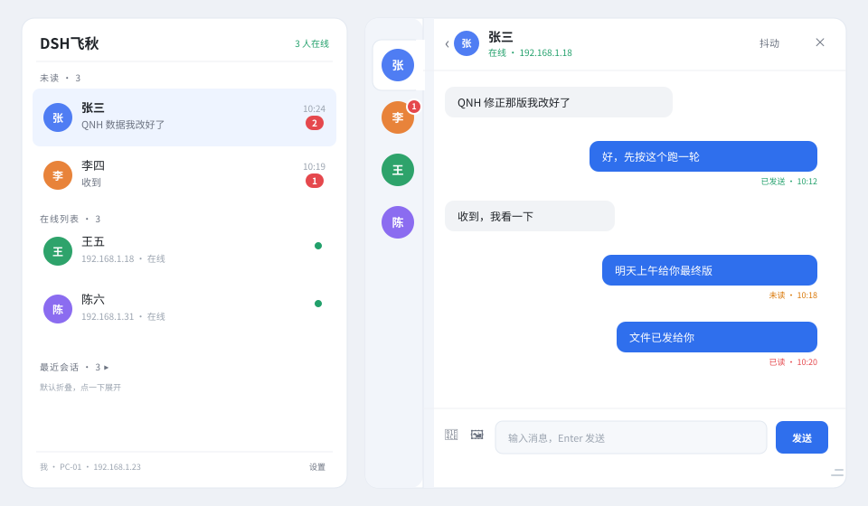

# DSH飞秋 · dsh-feiq-im

[](LICENSE)
[](https://github.com/jiangsuyuan/dsh-feiq-im/actions/workflows/test.yml)
[](package.json)

给 [DeepSeek Harness](https://github.com/deepseek-ai/deepseek-harness) 的局域网即时通讯插件：**工作区右侧常驻气泡 + 未读角标 + 逐条送达/已读**，同网段自动发现、不需要加好友，并兼容**飞秋 / 飞鸽传书（IPMsg 协议）**。



## 为什么做它

飞秋式的局域网聊天之所以好用，是因为三件事：**不用加好友**、**消息来了看得见**、**知道对方收没收到**。常见插件把入口放在左侧导航里，不在那个面板时消息来了毫无感知；这个插件把入口放在工作区右侧，未读数直接显示在气泡上。

## 功能

| 能力 | 说明 |
| --- | --- |
| 自动发现 | UDP 2425 广播，上线即出现在列表，零添加 |
| 明文文本 | 与飞秋 / 飞鸽互发，`RECVMSG` 送达、`READMSG` 已读 |
| 状态提示 | 文字消息：已发送（绿）、未读（黄）、已读（红） |
| 闪屏震动 | 会话头部一键抖动；收到对方抖动时气泡震动 |
| 图片 | 512 字节 UDP 分片、确认与超时补发、点击放大 |
| 文件 | 报价 + TCP `GETFILEDATA`，带接收进度与取消 |
| 未读角标 | 气泡总数、会话行数字、头像栏角标 |
| 可拖动气泡 | 位置与面板尺寸记忆；面板打开时气泡隐藏，关闭后回到原位 |
| 2425 体检 | 被飞秋占用时提示，可一键关闭飞秋并重启监听 |

## 兼容性

| 对端 | 文本 | 送达/已读 | 图片 | 文件 | 抖动 |
| --- | --- | --- | --- | --- | --- |
| 飞秋 3.0.0.1（实测） | ✅ | ✅ | ✅ 收发 | ✅ 收发 | ✅ |
| 飞鸽传书 / 标准 IPMsg | ✅ | ✅ | 视实现 | ✅ | 视实现 |
| 本插件 ↔ 本插件 | ✅ | ✅ | ✅ | ✅ | ✅ |

- 测试基线：Windows + DSH Desktop `0.2.2-rc.5`，飞秋 3.0.0.1。
- 不实现飞秋的加密会话：本插件不发布公钥，因此双方保持明文（已实测）。
- 群聊、文件夹传输、远程协助不在当前版本。

## 安装

要求：Windows、DSH Desktop ≥ 0.2.2-rc.5、Node 22+（DSH 自带）。

从 GitHub 安装：

```bash
dsh plugin --profile desktop add github:jiangsuyuan/dsh-feiq-im
```

或本地目录安装：**Plugins → Add plugin → 选择本目录**，启用后重启 DSH。

安装后工作区右侧出现 `DSH飞秋` 气泡；若提示 2425 被占用，点横幅里的「关闭飞秋并启用」。

## 使用

1. 入口默认是**会话区左侧、输入框上方的浮动气泡**（可拖动）；在设置里可以切换成**输入框工具行按钮**（同样带红色未读角标）。
2. 点任意在线的人直接聊天；对方上线/下线在 10–30 秒内刷新。
3. 输入框支持 `Enter` 发送、`Shift+Enter` 换行、`Ctrl+V` 粘贴截图。
4. 点图片可放大；文件卡片显示进度和取消；失败的消息可点击重试。
5. 会话头部：返回、头像、在线状态、**抖动**、关闭。

## 与飞秋同机共存

飞秋和本插件都使用 **UDP/TCP 2425**，并且飞秋按"源 IP"认设备，因此**同一台机器上二者只能开一个**。面板顶部横幅提供「关闭飞秋并启用」，只会结束"占用 2425 且进程名匹配飞秋"的进程，需要一次确认。

接收文件依赖 TCP 2425；若飞秋占着该端口，会显示"文件服务未启动"。

## 协议概要

- 报文：`ver:packetNo:user:host:cmd:extra`，飞秋在 `ver` 前带 `#` 私有头（MAC 等）。
- 命令：`BR_ENTRY 0x1`、`ANSENTRY 0x3`、`BR_EXIT 0x2`、`SENDMSG 0x20`、`RECVMSG 0x21`、`READMSG 0x30`、`GETFILEDATA 0x60`、`SENDIMAGE 0xC0`、`KNOCK 0xD1`。
- 昵称：飞秋从 `ANSENTRY` 的 `extra` 取显示名，`user` 只是账号名。
- 编码：GBK（发送）/ GBK 或 UTF-8（自动识别）；零依赖编码器由解码表反推。
- 图片：`id|total|offset|chunks|index|chunkLen|0|code|0|flags#` + 一个 NUL + 原始字节，512 字节一片，`0xC1` 逐片确认。
- 文件：`SENDMSG|FILEATTACH`，条目 `id:name:sizeHex:mtimeHex:typeHex:`，以 `0x07` 分隔；接收方连对端 TCP 2425 发 `GETFILEDATA`，附加段为十六进制 `报价packetNo:fileId:offset:`。

更细的实测记录见 [docs/DESIGN.md](docs/DESIGN.md) 附录 B/C。

## 隐私与安全

- **明文传输**：与飞秋一致，同网段可抓包，不要传凭据。
- 浏览器侧 API 只注册在 DSH 回环 web server 上，并校验同源。
- 入站报文做长度与边界校验；TCP 文件服务只响应本机报价过的 `packetNo+fileId`。
- 数据目录：`~/.dsh/plugin-data/dsh-feiq-im/`（消息 JSONL、图片/文件、状态）。

## 开发

```bash
node test/ipmsg.test.mjs        # 报文编解码（20）
node test/feiq-image.test.mjs   # 图片分片（8）
node test/app.test.mjs          # 引擎：文本/回执/抖动/文件/进度（7）
```

仓库结构：

```
index.js             宿主入口（Cordis apply）
client.js            浏览器半侧（气泡 / 面板 / 会话）
src/host/ipmsg.js    IPMsg / 飞秋报文编解码
src/host/feiq-image.js 图片分片收发
src/host/app.js      发现、消息、回执、文件、状态机
src/host/routes.js   /feiq-im/* 路由与 SSE
src/host/net.js      UDP/TCP、端口占用识别
src/host/store.js    身份、状态、消息、文件落盘
docs/                设计文档与检查报告
test/                自动化测试
```

## 免责声明

本项目与飞秋官方无关，仅实现 IPMsg 协议兼容，**不是飞秋官方出品**。使用前请确认所在网络环境允许此类广播通信。

## License

[MIT](LICENSE)
